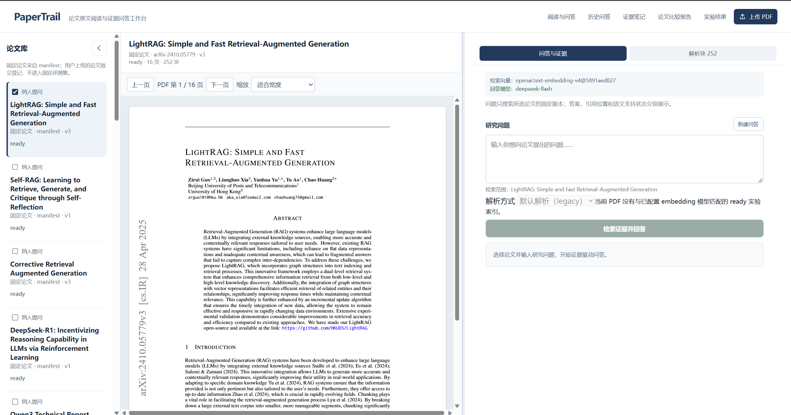
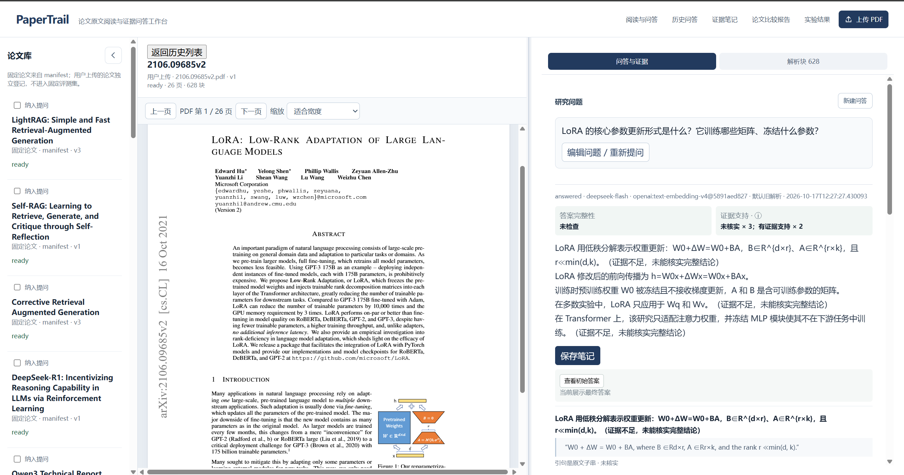
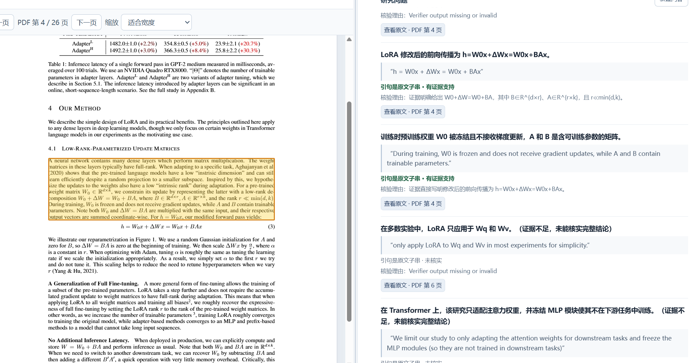
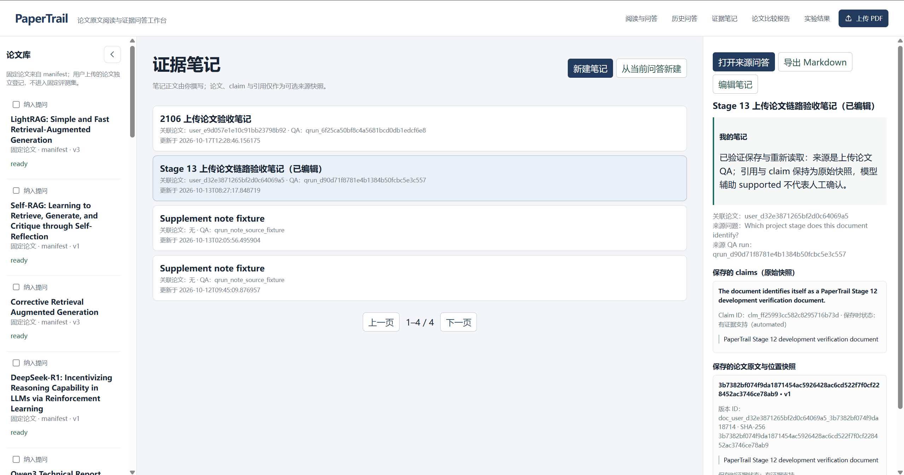
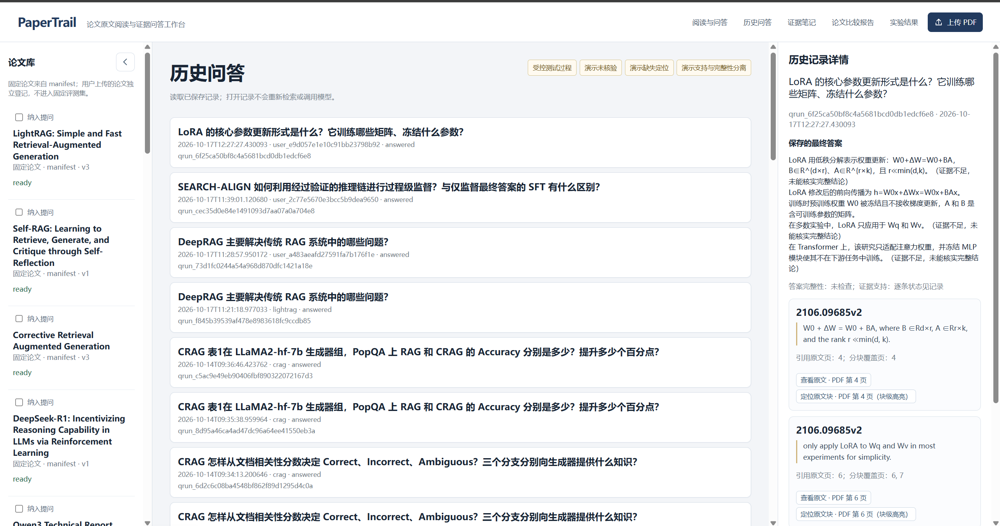
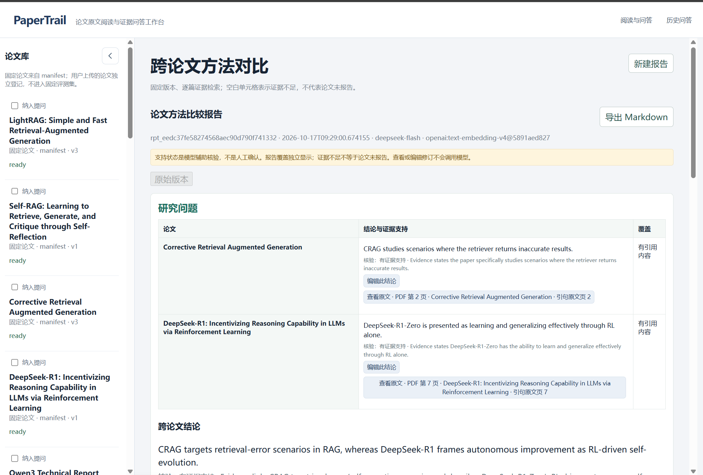
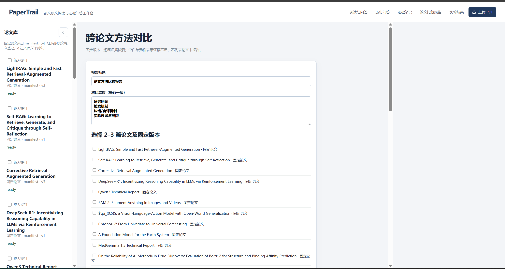
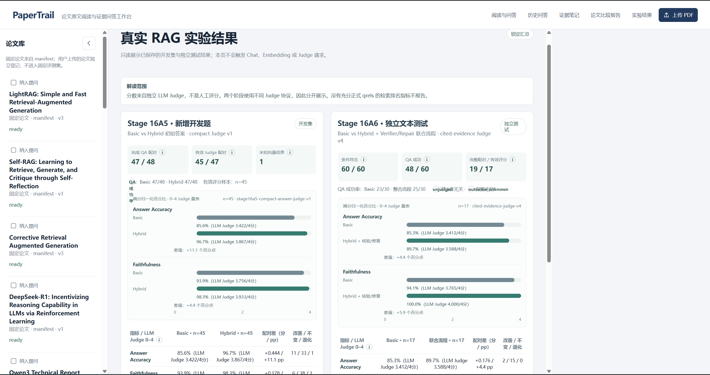
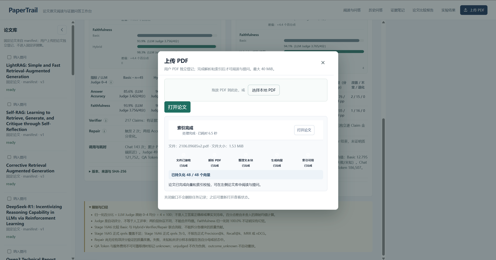
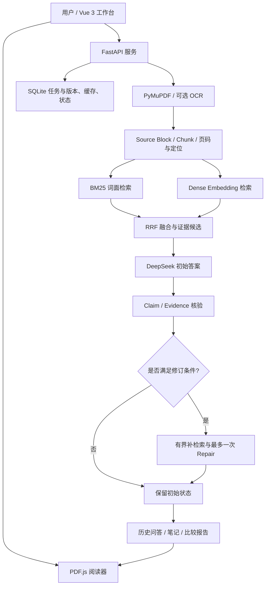

# PaperTrail

**论文原文阅读与证据驱动的 RAG 问答工作台**  
*Evidence-grounded Research Paper Reading & RAG QA Workspace*

[项目源码](https://github.com/liucai111/PaperTrail) · [功能演示指南](docs/demo-guide.md) · [项目简历介绍](docs/resume-project.md) · [系统架构](docs/architecture-overview.md) · [部署与复现](docs/deployment-and-reproduction.md)

> **项目定位**：不是只给出一段流畅的论文摘要，而是把「用户提问 → 混合检索 → 引用原文 → Claim 级核验 → 有界修订 → 研究笔记」连接为一个可追溯、可复查的论文研读流程。
>
> **发布范围**：本公开仓库是安全整理的源码与演示版本。**不包含原论文 PDF、私有 Gold/题目、qrels、原始评测记录、用户上传文件和生产数据库**。公开的实验展示仅使用经过筛选的汇总结果。

## 目录

- [项目概览](#项目概览)
- [核心功能与截图](#核心功能与截图)
- [技术架构与数据流](#技术架构与数据流)
- [核心工程设计](#核心工程设计)
- [真实实验与结果解读](#真实实验与结果解读)
- [本地启动](#本地启动)
- [目录结构与公开版说明](#目录结构与公开版说明)
- [使用与演示建议](#使用与演示建议)
- [已知限制](#已知限制)
- [许可与版权](#许可与版权)

## 项目概览

论文研读通常要在 PDF、生成式问答、引用记录和人工笔记之间不断切换。单纯的 RAG 系统即使回答流畅，也可能存在**引用位置不准、引句与结论不匹配、请求失败后重复调用、无法恢复阅读上下文**等问题。

PaperTrail 将 PDF 阅读器和证据问答放在同一个工作区：在左侧阅读论文，在右侧提问并查看答案及证据；可从详细证据条目跳转到 PDF 相应页面，保存笔记，回看历史问答，并对多篇论文生成有来源约束的方法比较。

| 方向 | 当前实现 |
|---|---|
| 文档处理 | PyMuPDF 解析文本与页码、来源块/chunk 对应、可选 RapidOCR 兜底 |
| 检索 | BM25 词面召回 + Dense 向量召回 + Reciprocal Rank Fusion（RRF） |
| 生成与核验 | DeepSeek 问答、Claim 级证据核验、最多一次有界 Repair 与复检 |
| 可追溯阅读 | PDF.js 阅读、页码/来源定位、证据详情、历史页码恢复 |
| 研究记录 | 问答历史、证据笔记、跨论文方法比较、不可覆盖的报告修订快照 |
| 工程可靠性 | SHA-256 去重、SQLite 持久任务、向量缓存、断点续建、结果未知保护 |
| 评测 | 开发集与独立测试分开展示；真实保存的离线汇总、样本量和局限说明 |

**技术栈**：Python 3.13 · FastAPI · SQLAlchemy · SQLite · PyMuPDF · HTTPX · Vue 3 · TypeScript · Vite · PDF.js · BM25 · 阿里云百炼 `text-embedding-v4` · DeepSeek。

## 核心功能与截图

下列截图来自实际运行的 PaperTrail 界面；截图仅用于展示功能，**不代表相关答案已得到人工事实确认**。

### 1. 双栏论文阅读工作台

支持固定论文和经过验证的上传论文；PDF 默认适合宽度，论文库可收起，阅读区与答案区可调整比例。切换论文、打开历史问答或刷新页面后，可恢复关联版本与 PDF 页码。



### 2. RAG 问答与证据核验

选择论文后提问，后端从限定论文范围检索、融合证据并生成答案。页面分别展示初始/最终答案、Claim、引用原文和核验结果，避免将“字串匹配”直接等同于“事实得到支持”。支持保留未核实及证据不足状态。



### 3. PDF 引用跳转与来源定位

从详细答案的原文来源入口定位对应论文页与来源块，在阅读器中高亮候选区域。**来源块定位、引句一致性与语义支持是不同概念**；对复杂 PDF 版面及 bbox 不确定情况保留限制说明。



### 4. 证据笔记与历史记录

可以为问答、论文和引用保存证据笔记，并在历史记录中重新打开既有答案和阅读位置；也可以回看记录时的来源版本与核验状态。



<details>
<summary>查看历史问答页面</summary>



</details>

### 5. 跨论文方法比较

选择已有论文、设定比较主题，在固定版本的证据基础上输出方法差异、参考来源、置信与限制说明。支持保存比较报告、Markdown 导出和非覆盖式报告修订。



<details>
<summary>查看论文比较的配置界面</summary>



</details>

### 6. 真实 RAG 实验结果

页面以**只读方式**展示 Stage 16A5 与 Stage 16A6 已保存汇总，保留评分协议、有效样本数、失败情况、Verifier/Repair 结果和 qrels 限制；打开该页不会触发 Chat、Embedding 或 Judge 调用。



<details>
<summary>查看 PDF 上传与增量索引任务界面</summary>

上传端包含解析/索引进度、任务恢复和异常状态显示；成功向量即时持久化，`outcome_unknown` 不自动重发。



</details>

更多说明见 [五分钟演示脚本](docs/demo-guide.md)；完整图片列表见 [功能截图索引](docs/screenshots.md)。

## 技术架构与数据流



**数据边界**：运行时生成答案只使用当前选定论文可检索的内容和实际引用证据；冻结 Gold/Rubric 属于**离线评测资料**，不允许进入实时检索、生成、核验或修复流程。公开版不包含私有 Gold。

## 核心工程设计

**混合检索**：BM25 处理词面匹配，Dense 负责语义候选，RRF 在共享检索空间中融合排序。对照实验严格区分 Basic（BM25）和 Hybrid（BM25 + Dense + RRF），并保留 Top-k、来源版本与引用快照。

**证据核验不是简单字符串搜索**：系统可将答案划分为 Claim，保留 `supported`、`unverified` 等状态和引用原文。来源块命中只证明存在定位候选，不能自动证明对应结论正确。满足既有触发规则时，最多开展一轮有界 Repair，保留修订前后结果。

**上传索引与可靠恢复**：PDF 按 SHA-256 去重；解析、分块、向量生成均有独立进度。成功向量逐批原子持久化并按模型、维度及内容哈希复用；如果模型请求已经发送但没有明确响应，标记为 `outcome_unknown`，不自动重发，以避免未知重复处理与可能计费。

**版本隔离与阅读状态**：PDF 与解析版本绑定来源身份；结构化 Parse Snapshot 是独立实验方案，Legacy 仍是默认路径；引用跳转、历史恢复都以保存的版本和页码为准。

**工程组织**：本地单用户 FastAPI + SQLite，API/Web 由统一 Windows 启动器管理，常规演示优先使用已保存记录，避免无必要的真实模型请求。

## 真实实验与结果解读

两组评测均来自已保存实验；**Stage 16A5 与 16A6 使用不同 Judge 协议，不能合并计算一个统一准确率均值**。评分区间为 0–4 分，下表百分比是**LLM Judge 均分占满分的比例**，并非真实答案正确率、人类核验率或统计显著性结论。

| 数据与指标 | Basic | Hybrid / 联合流程 | 差值 | 有效配对 |
|---|---:|---:|---:|---:|
| Stage 16A5 新增开发题 · Answer Accuracy | 85.6%（3.422/4） | 96.7%（3.867/4） | +11.1 pp | 45 |
| Stage 16A5 新增开发题 · Faithfulness | 93.9%（3.756/4） | 98.3%（3.933/4） | +4.4 pp | 45 |
| Stage 16A6 独立文本测试 · Answer Accuracy | 85.3%（3.412/4） | 89.7%（3.588/4） | +4.4 pp | 17 |
| Stage 16A6 独立文本测试 · Faithfulness | 94.1%（3.765/4） | 100.0%（4.000/4） | +5.9 pp | 17 |

- **开发集**：冻结题目 72 道，完成 Basic/Hybrid QA 配对 **66/72**。新增 48 道中完成 **47/48** 组问答配对，**45** 组取得有效 LLM Judge 配对。新增样本的 Accuracy 改善/不变/退化为 **11/33/1**，Faithfulness 为 **6/38/1**。
- **独立测试**：30 道文本题、60 个条件，完成 QA **48/60**，有效配对 Judge **17 组**。这里的对照是 **Basic 与 Hybrid + Verifier/Repair 联合流程**，不能将总差异分别归因于每个模块。
- **Verifier / Repair**：新增开发样本 Verifier 记录 217 条 Claim（172 `supported`、43 `unverified`、2 `partially supported`）；Repair 实际触发 2 次，修订前后 Accuracy/Faithfulness 均为 **4→4**，未观察到评分改善。独立测试的 Repair 未取得经评测证实的质量收益。
- **检索评价限制**：正式 qrels 对 Top-k 检索结果的判断覆盖不足，**不报告正式 Precision@k、Recall@k、MRR 或 nDCG**；未判定项不等于负例。
- **成本与样本限制**：部分真实模型请求缺少可核验的 Token/费用数据，记为 `unknown`；失败、结果未知及无法评分的记录不当作 0 分，也不从分母中隐性消失。

公开仓库仅提供经脱敏的分层聚合结果；完整原始实验、题目、Gold、qrels 和 SHA 锁定记录不随仓库分发。公开摘要**不等同于完整的离线实验复现语料**。

## 本地启动

> 推荐 Windows 11 + PowerShell；要求 **Python 3.13、Node.js/npm**。首次克隆的公开版本自带空的论文 Manifest，**没有预置 PDF 或已生成向量索引**；无密钥时可检查 API/Web 启动和只读实验展示，但不能凭空运行真实论文问答。

```powershell
# 1. 克隆仓库
git clone https://github.com/liucai111/PaperTrail.git
cd PaperTrail

# 2. 安装后端依赖
py -3.13 -m venv .venv
.\.venv\Scripts\python.exe -m pip install -r apps\api\requirements-dev.txt

# 3. 安装前端依赖
Push-Location apps\web
npm.cmd ci
Pop-Location

# 4. 创建本地配置（如果已有 .env 则不要覆盖）
if (-not (Test-Path .env)) { Copy-Item .env.example .env }

# 5. 检查与启动
scripts\papertrail.cmd doctor
scripts\papertrail.cmd start
scripts\papertrail.cmd status
```

默认访问地址：Web `http://127.0.0.1:5181/`、API `http://127.0.0.1:8011/`。停止运行：`scripts\papertrail.cmd stop`；重启：`scripts\papertrail.cmd restart`。其他环境与依赖详情见 [部署与复现](docs/deployment-and-reproduction.md)。

**接入真实问答**：在本地 `.env` 中填写 `PAPERTRAIL_LLM_API_KEY` 与 `PAPERTRAIL_EMBEDDING_API_KEY`，并遵守对应服务商的调用与费用规则。不要把真实 Key 写入源码、截图、终端日志或 GitHub 提交。

**导入自己的论文**：使用页面右上角“上传 PDF”入口。通过文件校验、解析和完整向量索引校验后才能将该版本标记为 `ready` 并用于问答。用户上传论文不会自动加入冻结评测集。

**前端生产构建**：

```powershell
Push-Location apps\web
npm.cmd run build
Pop-Location
```

> 安全说明：公开发行包的测试以不依赖私有语料的 Mock/合成样例为主；包含固定原始论文的回归测试需要额外语料，不应被表述为开源仓库可零配置复现。

## 目录结构与公开版说明

```text
PaperTrail/
├── apps/
│   ├── api/                 # FastAPI 服务、解析、检索、任务和状态
│   └── web/                 # Vue 3 阅读/问答/笔记/实验页面
├── assets/screenshots/     # README 使用的真实功能截图（本次新增）
├── docs/                   # 架构与部署文档、演示和简历材料
├── public-data/            # 经过筛选的实验聚合指标与来源说明
├── scripts/                # Windows 启动器等公开工具
├── data/samples/           # 公开版空 Manifest（不包含论文 PDF）
├── .env.example            # 不含真实密钥的配置模板
└── README.md
```

公开版本的截图是功能展示材料；真实运行产生的 SQLite、上传论文、缓存、日志和任务状态应留在本地，不加入公开仓库。部分内部验证工具、原始实验记录和第三方 Skill 未随公开发行包分发。

## 使用与演示建议

1. **无需模型调用的演示**：展示 README 截图、只读实验结果、架构与已保存数据边界。适合 GitHub 浏览和离线讲解。
2. **完整私有工作区演示**：使用已保存的成功论文/问答，演示 PDF 阅读、引用跳转、笔记、历史与跨论文比较；不要把私有运行数据复制进公开版本。
3. **自行导入并提问**：在本地配置合法模型凭据、上传自己的 PDF，等待索引 `ready` 后使用真实检索问答；外部模型调用可能产生费用或结果未知状态。

详细的 5 分钟讲解词、操作时间线、失败兜底和演示前检查请见 [五分钟演示指南](docs/demo-guide.md)。

## 已知限制

- LLM Judge 是自动评分；归一化 100.0% 不表示“完全正确”或“无幻觉”。两阶段协议与有效样本不一致，不做跨阶段混合均值或普遍质量提升结论。
- 目前正式 qrels 不足以支持完整的检索排序指标；Claim 支持状态也不能直接视为独立人工标注真值。
- Repair 尚未得到可靠的实测质量提升证据；结构化 Parse Snapshot 未证明普遍优于默认 Legacy。
- OCR 只作为选配；复杂双栏、表格、公式、图像和 bbox 定位仍可能需要人工核查。
- 本项目为本地单用户研究原型，不提供多用户权限体系、分布式任务 worker 或生产 SLA。
- 公开仓库未附带原始实验语料，不能仅凭公开汇总重跑完整 Stage 16 质量实验。

## 许可与版权

本项目采用 [MIT 许可证](LICENSE)，允许使用、复制、修改、合并、发布、分发、再许可和销售本项目软件的副本，但须在软件的所有副本或重要部分中保留版权声明和许可声明。软件按“原样”提供，不附带任何担保，完整条款见根目录 `LICENSE`。

第三方依赖保留各自的版权与许可证；本项目的 MIT 许可不替代第三方许可。论文 PDF、论文内容及截图中展示的论文材料仍属于原作者或权利人，不因本项目采用 MIT 而获得额外授权。

---

**PaperTrail 的核心原则：答案可追溯、证据可核对、失败可恢复、实验不夸大。**

[GitHub 仓库](https://github.com/liucai111/PaperTrail) · [五分钟演示](docs/demo-guide.md) · [简历与面试表述](docs/resume-project.md)
