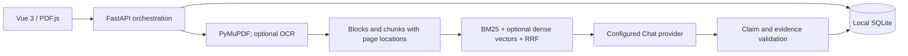

# Architecture

The API owns request validation, task persistence and orchestration. Provider adapters use independently configured Chat and embedding services. Retrieval and chunking remain provider-independent. PDF version hashes and ready-index checks scope retrieval. The public repository carries no paper PDFs, local database, upload cache or evaluation answers. The experimental results view reads only sanitized aggregate JSON and does not call providers.
