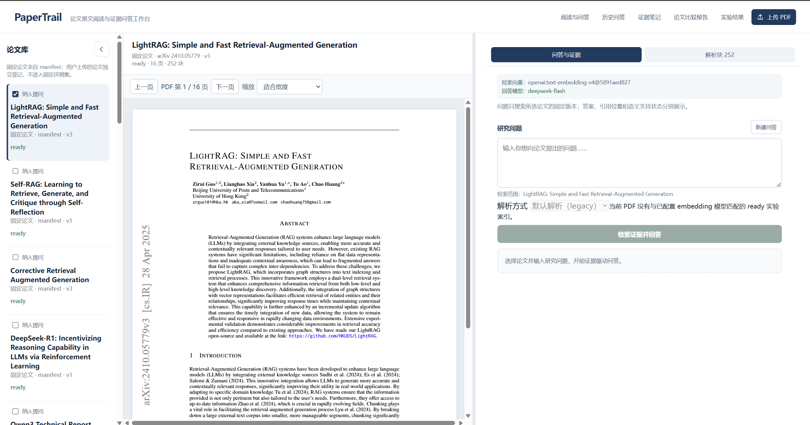
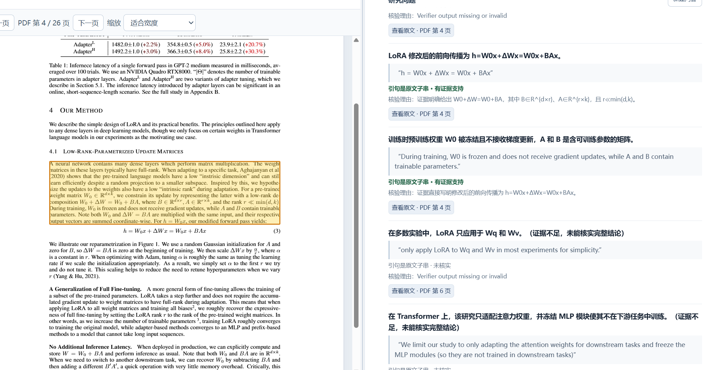
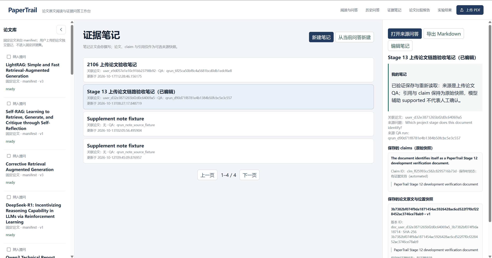
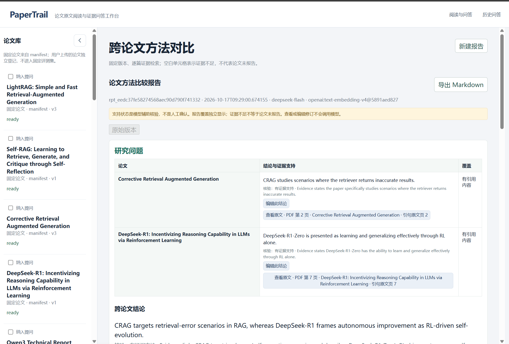
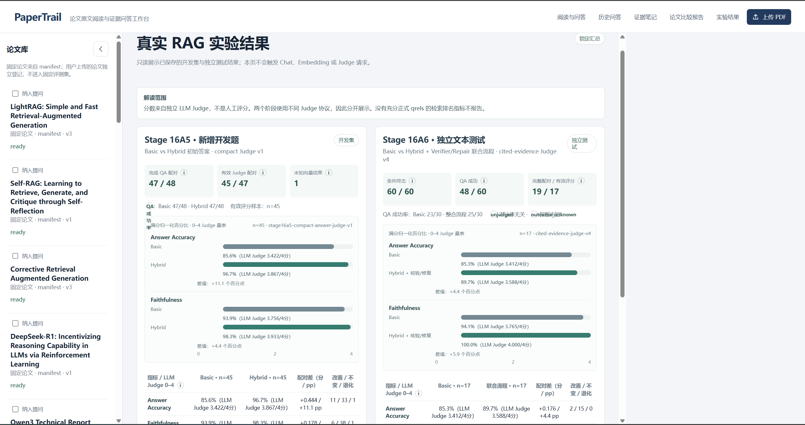

# PaperTrail 功能截图索引

本目录的截图均从项目运行截图文档中提取，保留原界面信息，没有编造功能和指标。适用于 GitHub README、实习项目作品集与线下演示；截图不是对模型答案准确性的人工背书。

| 文件 | 功能说明 | 推荐使用场景 |
|---|---|---|
| `01-paper-reader.png` | LightRAG 论文阅读器、左侧论文库、右侧问答 | README 首屏 / 演示开场 |
| `02-qa-and-evidence.png` | LoRA 论文问题、答案与证据详情 | 讲混合检索、核验状态 |
| `03-evidence-pdf-highlight.png` | 原文高亮及右侧详细 Claim 证据 | 讲“证据可定位” |
| `04-qa-history.png` | 历史问答列表及右侧相关内容 | 讲持久化与历史恢复 |
| `05-evidence-notes.png` | 证据笔记及关联论文 | 讲知识积累与笔记 |
| `06-cross-paper-compare.png` | 跨论文比较报告 | 讲跨论文研究工作流 |
| `07-rag-evaluation.png` | 开发集和独立测试只读实验结果 | 展示真实实验数据 |
| `08-pdf-upload.png` | 用户 PDF 上传/任务状态弹窗 | 讲异步索引与恢复机制 |
| `09-compare-settings.png` | 方法比较主题与论文选择 | 讲报告配置 |

## 重点展示

### 阅读工作台

### 引用与原文证据

### 研究笔记

### 跨论文对比

### 真实实验结果

## 使用建议

- README 正文展示 **4～6 张**，其余使用可折叠的 `
` 或此页面。
- 演示讲解优先展示**完整工作台截图**，不是脱离上下文的单张数字图。
- 不裁去代表失败、未核验、证据不足的状态后再将截图解读为“全部通过”。
- 如果后续界面改变，应更新对应截图与其说明，不要使用过期页面冒充现行实现。
